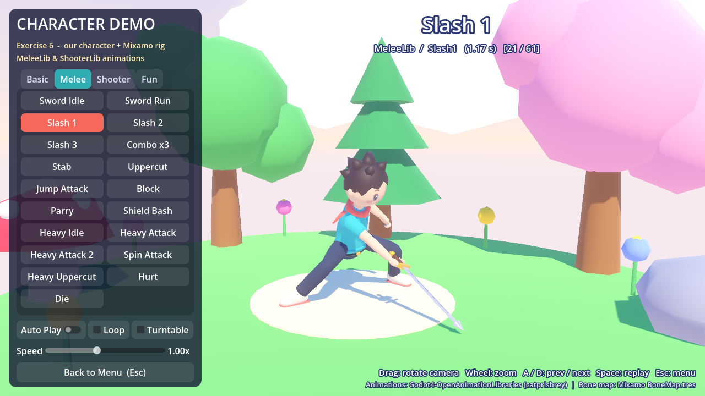

# Skybound Bot – แบบฝึกหัดที่ 6 First 3D Character (Godot 4.7)

## วิธีเล่น
| ปุ่ม | การทำงาน |
|---|---|
| W A S D / ลูกศร | เดิน |
| Space | กระโดด (กดซ้ำกลางอากาศ = Flip กระโดดสองชั้น) |
| เมาส์ หรือ Q / E | หมุนกล้อง |
| R | เริ่มด่านใหม่ |
| Esc | แสดง/ซ่อนเมาส์ (ในฉาก Demo = กลับเมนู) |

เป้าหมาย: หลบกับดัก เก็บ **เหรียญให้ครบ** แล้วเข้า **ประตู** ไปด่านต่อไป
มีหัวใจ 3 ดวง ชนกับดัก/ตกเหวเสียหัวใจ 1 ดวง หมดหัวใจ = เริ่มด่านใหม่

ฉาก Character Demo: คลิกปุ่มท่าทาง, ลากเมาส์ = หมุนกล้อง, ล้อเมาส์ = ซูม, A / D = ท่าก่อนหน้า/ถัดไป, Space = เล่นซ้ำ

## ฉากในเกม
- `Scenes/Menu/main_menu.tscn` – หน้าเมนู
- `Scenes/Levels/level_01.tscn` – **Sunny Skylands**
- `Scenes/Levels/level_02.tscn` – **Ember Ruins**
- `Scenes/Menu/win_screen.tscn` – หน้าจบ
- `Scenes/Demo/character_demo.tscn` – **Character Demo** (ใหม่ในข้อ 6)

## ไฟล์สำคัญ
- `Tools/build_character.py` – สร้างโมเดล + rig + texture ใบหน้า
- `Tools/blender/` – สคริปต์ Blender + `character.blend`
- `MixamoUpload/*.zip` – ไฟล์สำหรับอัปโหลดเข้า Mixamo
- `Assets/Characters/player.glb` (+ `.import` ที่ตั้ง Bone Map ไว้)
- `Assets/AnimLibs/` – `Mixamo BoneMap.tres`, `MeleeLib.res`, `ShooterLib.res`
- `Scripts/character_model.gd` – โหลดตัวละคร/อนิเมชันให้ Player
- `Scripts/character_demo.gd` – ฉาก Demo
- `Screenshots/` – ภาพหน้าจอ Blender, Godot Editor และตอนเล่น

## เครดิต
- Animation libraries + Mixamo bone map: [Godot4-OpenAnimationLibraries](https://github.com/catprisbrey/Godot4-OpenAnimationLibraries) โดย catprisbrey
- 3D Platformer Starter Kit โดย Silver Demon Studios (CC0) – โค้ดควบคุมผู้เล่นต้นแบบ (แบบฝึกหัดที่ 5)
- ฉาก, เสียง และตัวละครสร้างเองทั้งหมด
